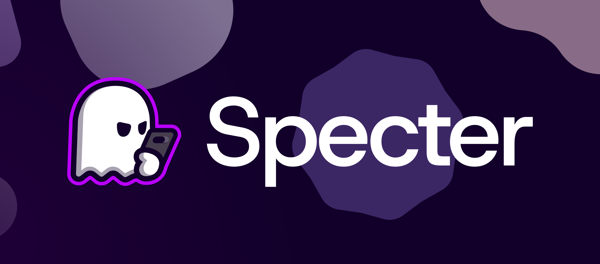

# Specter

<p align="center">
  
</p>

[](https://github.com/dpejoh/specter/releases/latest)
[](https://github.com/dpejoh/specter/actions/workflows/build-test.yml)

Strong integrity, TEESimulator management, detection cleanup. Clean, focused, no bloat.

[Download](https://github.com/dpejoh/specter/releases/latest)

## Support

- Telegram: [Channel](https://t.me/dpejoh) · [Group](https://t.me/dpejoh0)
- Ko-fi: [ko-fi.com/dpejoh](https://ko-fi.com/dpejoh)
- BTC: bc1qfy4vfstns4aqhvck66x0r53n3hfkkzhwkt7zpw
- ETC: 0x895762C0Fd2BeF54EE3cD478Fc03212aeA673a68

## Quick start

1. Install [Tricky Store](https://github.com/5ec1cff/TrickyStore/releases/latest) /
   [TEESimulator](https://github.com/JingMatrix/TEESimulator/releases/latest) /
   [Tricky Store OSS](https://github.com/beakthoven/TrickyStoreOSS/releases/latest)
   (Specter auto-installs Tricky Store OSS if none found; skip if using OhMyKeymint)
2. Install [Play Integrity Inject](https://github.com/KOWX712/PlayIntegrityFix/releases/latest)
   or [Play Integrity Fork](https://github.com/osm0sis/PlayIntegrityFork/releases/latest)
3. Install Specter via Magisk / KernelSU / APatch
4. Reboot. First-boot runs backup, target, security patch, keybox.
5. Open the WebUI

## Features

- **Keybox**: multi-source catalog, revocation watch with auto-replace, custom keybox, backup/restore
- **Auto Target**: inotify + polling for new apps
- **App Targeting**: per-app states, suffixes
- **Security Patch**: live fetch with offline fallback
- **ROM Fingerprint**: cleans custom ROM props and prefixes
- **ADB Disabler**: dev options, USB debugging, OEM unlock
- **PIF**: auto-detect variant, apply a preferred fingerprint or fetch one
- **GMS Kill**: force-stops DroidGuard/GMS, clears Play Store
- **HMA-OSS**: scope manager page, config generation, auto-update
- **Zygisk Next**: detection and configuration
- **Detection Cleanup**: removes detector logs, temp dirs, caches
- **Widevine L1**: attestation keys via KmInstallKeybox
- **Conflict Resolution**: aggressive modules disabled, passive coexists, TEESimulator WebUI feature ownership
- **Scheduler**: keybox revocation watch, auto-target, HMA auto-update, autopif
- **First-Boot**: backup originals, run full pipeline once

## Build

```bash
git clone https://github.com/dpejoh/specter
cd specter
npm install
npm run build
```

Output: `Specter-v{version}-g{hash}.zip`

## Translations

The WebUI is translated into Arabic, Spanish, French, Hungarian, Indonesian, Polish, Russian, Turkish, Vietnamese, and Chinese (mostly AI-generated. Human review welcome).

To contribute translations:
- **Preferred**: Join the [Crowdin project](https://crowdin.com/project/specter-module) (web UI, no git needed)
- **Alternative**: Edit the JSON files in `src/webroot/lang/` and submit a PR

## Disclaimer

For educational purposes only. The developer does not condone illegal activities, including bypassing DRM, violating terms of service, or committing fraud; users are solely responsible for complying with applicable laws.

Specter is programmed not to cause problems, but an unlocked phone always comes with risks. Nothing is 100% guaranteed: your warranty may be voided, apps may break, and account bans are possible. Use at your own risk, and always maintain backups of important data.

## Thanks

- [chiteroman](https://github.com/chiteroman/PlayIntegrityFix), [KOWX712](https://github.com/KOWX712/PlayIntegrityFix) and [osm0sis](https://github.com/osm0sis/PlayIntegrityFork). PIF and forks.
- [5ec1cff](https://github.com/5ec1cff/TrickyStore), [JingMatrix](https://github.com/JingMatrix/TEESimulator), [beakthoven](https://github.com/beakthoven/TrickyStoreOSS). Tricky Store and forks.
- [KOWX712](https://github.com/KOWX712/Tricky-Addon-Update-Target-List), [Enginex0](https://github.com/Enginex0/tricky-addon-enhanced). Tricky Store Addon.
- [eltavine](https://github.com/eltavine/Duck-Detector-Refactoring). Duck Detector.
- [Citra-Standalone](https://github.com/Citra-Standalone/TSupport-Advance). TSupport-Advance.

## License

GNU GPL v3.0
